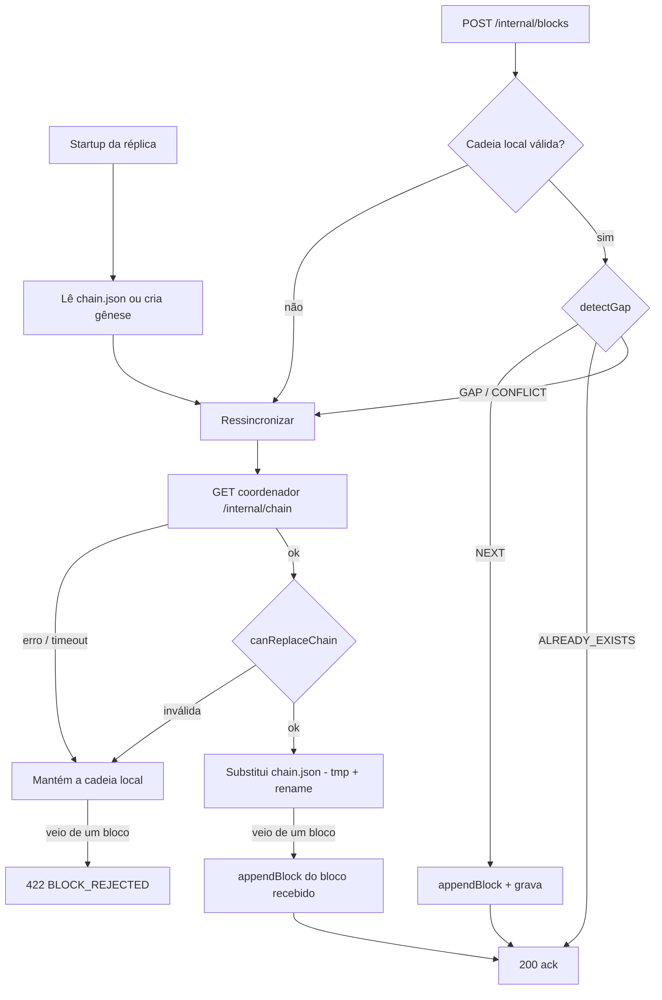

# Especificação da Feature: 003 — Nós NestJS (coordenador e réplicas)

**Branch sugerida**: `docs/003-nodes` (documentação) → `feat/003-nodes` (implementação)

**Criada em**: 2026-11-27

**Status**: Rascunho (aguardando revisão do Flávio; questões Q1–Q5 com proposta padrão)

**Entrada**: Substituir o esqueleto de `apps/node` por um nó de blockchain NestJS que roda em dois papéis com a mesma imagem (`ROLE=coordinator|replica`). Ele persiste a cadeia em `/data/chain.json`, expõe a API REST que a web (spec 004) consome (RF01–RF06 e RF08), replica cada bloco do coordenador para as réplicas com confirmação por maioria (RD04, RD05) e recupera réplicas desatualizadas (RD06). Usa só a API pública de `@sd/chain-core` (spec 002). Inclui testes unitários, de integração e e2e (pirâmide na seção "Testes").

## Contexto e mapeamento com o enunciado

| Item do enunciado | O que a 003 entrega | Quem completa |
|-------------------|---------------------|---------------|
| RF01 — Cadastro | `POST /properties` no coordenador → bloco `REGISTRATION` confirmado | 004 (tela) |
| RF02 — Listagem | `GET /properties` em qualquer nó (estado derivado da cadeia) | 004 |
| RF03 — Transferência | `POST /properties/:propertyId/transfers` no coordenador → bloco `TRANSFER` | 004 |
| RF04 — Histórico | `GET /properties/:propertyId` com `history` | 004 |
| RF05 — Visualização | `GET /blocks` (blocos crus do disco, com hashes) | 004 |
| RF06 — Integridade | `GET /status` relê `/data/chain.json` e roda `validateChain` | 004 (botão "verificar") |
| RF07 — Servidor web | — (é da web; o nó só devolve o header `X-Node-Id`) | 001/004 |
| RF08 — Monitoramento | `GET /status` e `GET /health` por nó | 004 (indisponível = sem resposta) |
| RD03 — REST/HTTP | Web ↔ nós e nó ↔ nó só por HTTP, com nomes de serviço do Compose | — |
| RD04 — Replicação | Coordenador fixo cria, ordena (mutex) e distribui os blocos | — |
| RD05 — Maioria | Confirma só com o bloco no coordenador **e** ack de ≥ 1 réplica em até 2 s; senão 503 | — |
| RD06 — Recuperação | Réplica baixa a cadeia completa do coordenador no startup ou em lacuna, valida (`canReplaceChain`) e substitui | — |
| RD07 — Persistência | `chain.json` por nó, em volume próprio, com escrita atômica | — |
| RD08 — Web sem estado | Nada de dados de imóveis fora da cadeia dos nós | 004 |

### Correspondência de termos (Constituição § VII)

| Enunciado (pt-BR) | Código / contrato |
|-------------------|-------------------|
| nó coordenador / réplica | `ROLE=coordinator` / `ROLE=replica` |
| imóvel | `property` (rotas `/properties`) |
| cadastro / transferência | `REGISTRATION` / `TRANSFER` (`/transfers`) |
| proprietário / novo proprietário | `owner` / `newOwner` |
| situação dos nós | `GET /status` |
| confirmação (ack) | resposta 200 de `POST /internal/blocks` com `{ "ack": true }` |

## User Scenarios & Testing

### História 1 — Cadastrar e transferir com confirmação por maioria (Prioridade: P1) 🎯 MVP

Como web (004), quero enviar cadastros e transferências ao coordenador e só receber sucesso quando o bloco estiver gravado no coordenador e em pelo menos uma réplica.

**Por que esta prioridade**: é o núcleo de RF01, RF03, RD04, RD05, T01 e T02.

**Teste independente**: e2e com os 3 nós no mesmo processo; `POST /properties` devolve 201 e o bloco 1 aparece em `GET /blocks` dos três nós.

**Cenários de aceite**:

1. **Dado** os 3 nós no ar com só a gênese, **Quando** faço `POST /properties` com `IMV001`, "Rua A, 100", "Maria Silva", **Então** recebo 201 com o bloco `index: 1`, e coordenador e réplicas têm `length: 2` (T01).
2. **Dado** `IMV001` de Maria, **Quando** transfiro para "João Souza", **Então** recebo 201 e `GET /properties/IMV001` em qualquer nó mostra dono atual João e histórico Maria → João (T02).
3. **Dado** `IMV001` já cadastrado, **Quando** cadastro de novo, **Então** recebo 409 `{ "code": "DUPLICATE_PROPERTY", "message": "O imóvel IMV001 já está cadastrado" }` e nenhum nó ganha bloco.
4. **Dado** `IMV999` inexistente, **Quando** transfiro, **Então** 404 `PROPERTY_NOT_FOUND`. **Dado** transferência para o dono atual, **Então** 422 `SAME_OWNER`. **Dado** campo vazio ou JSON inválido, **Então** 400 `INVALID_DATA`.
5. **Dado** duas requisições de escrita simultâneas, **Quando** chegam ao coordenador, **Então** são processadas uma de cada vez (mutex) e geram blocos 1 e 2 sem conflito.

---

### História 2 — Escrita bloqueada sem maioria (Prioridade: P1)

Como sistema, quero recusar a escrita quando nenhuma réplica confirmar em 2 s, sem deixar o bloco aparecer como confirmado.

**Por que esta prioridade**: tabela da RD05, T06 e T10.

**Cenários de aceite**:

1. **Dado** uma réplica parada, **Quando** cadastro, **Então** recebo 201 (a outra réplica confirmou) e as consultas continuam nos nós ativos (T05).
2. **Dado** as duas réplicas paradas, **Quando** cadastro, **Então** recebo 503 `NO_REPLICA_ACK` em até ~2 s e o coordenador continua com o mesmo `length` (T06).
3. **Dado** o coordenador parado, **Quando** consulto `GET /properties` numa réplica, **Então** recebo 200 com os últimos dados confirmados; **Quando** tento escrever numa réplica, **Então** recebo 503 `NOT_COORDINATOR` (T10).

---

### História 3 — Réplica desatualizada se recupera (Prioridade: P1)

Como réplica que voltou após ficar fora, quero pedir ao coordenador a cadeia completa, validá-la e substituir a minha.

**Cenários de aceite**:

1. **Dado** a réplica 2 parada enquanto 2 blocos são confirmados, **Quando** ela volta, **Então** no startup baixa `GET /internal/chain`, valida com `canReplaceChain`, substitui o arquivo e fica com o mesmo `length` e `lastHash` do coordenador (T07).
2. **Dado** uma réplica no ar que perdeu um bloco, **Quando** recebe um bloco com `index` à frente (lacuna, `GAP`), **Então** ressincroniza a cadeia inteira, anexa o bloco recebido e confirma (ack).
3. **Dado** uma réplica com um bloco que o coordenador não confirmou (`CONFLICT` no mesmo `index`), **Quando** recebe o próximo bloco, **Então** troca sua cadeia pela do coordenador, mesmo que seja mais curta (D3 da 002).
4. **Dado** o coordenador fora do ar no startup da réplica, **Então** ela sobe com a cadeia local e continua servindo leituras.

---

### História 4 — Integridade e situação de cada nó (Prioridade: P1)

Como web, quero saber de cada nó o papel, o tamanho da cadeia e se o arquivo em disco está íntegro, para RF06, RF08 e T08.

**Cenários de aceite**:

1. **Dado** a cadeia íntegra, **Quando** chamo `GET /status`, **Então** recebo `integrity.valid: true` e `length`.
2. **Dado** que edito à mão o `data.owner` do bloco 1 no `chain.json` de uma réplica, sem recalcular hashes, **Quando** chamo `GET /status` nela, **Então** recebo `integrity: { valid: false, invalidIndex: 1, reason: "INVALID_HASH", message: "Bloco 1: ..." }`, e os outros nós continuam válidos (T08).
3. **Dado** um `chain.json` que não é JSON válido, **Então** `GET /status` responde 200 com `integrity: { valid: false, invalidIndex: null, reason: "INVALID_JSON", ... }`.

---

### História 5 — Dados sobrevivem ao reinício (Prioridade: P2)

**Cenário de aceite**: **Dado** 2 blocos confirmados, **Quando** os 3 nós são fechados e recriados com os mesmos diretórios de dados, **Então** todos têm a mesma cadeia válida e o mesmo estado (T09).

### Edge Cases

- Arquivo `chain.json` inexistente no startup: o nó cria a cadeia só com a gênese (`createGenesisBlock`) e grava.
- Arquivo temporário `chain.json.tmp` sobrando de uma queda: é ignorado e sobrescrito na próxima escrita.
- Réplica responde ack depois dos 2 s: o coordenador já respondeu 503 e não gravou; essa réplica fica "à frente" e é corrigida na próxima replicação (`CONFLICT` → ressincroniza).
- Segunda réplica lenta depois que a primeira já confirmou: o coordenador responde 201 sem esperar; se ela perder o bloco, a próxima replicação detecta a lacuna.
- `propertyId` em minúsculas na rota (`/properties/imv001`): normalizado pela core (`normalizePropertyId`).
- Leituras durante uma escrita pendente nunca mostram o bloco pendente: ele só vai ao disco do coordenador depois do ack (D-W1).

## Requisitos funcionais

### Papel, configuração e persistência

- **FR-001**: Uma única imagem/app; o papel vem de `ROLE` (`coordinator` | `replica`), o nome de `NODE_ID`. Valores inválidos impedem o startup com erro claro.
- **FR-002**: Variáveis: `PORT` (3000), `DATA_DIR` (`/data`), `NODE_COORDINATOR_URL` (réplicas), `NODE_REPLICA_URLS` (coordenador, lista separada por vírgula), `ACK_TIMEOUT_MS` (2000). No Compose, URLs só com nomes de serviço (`http://node-replica-1:3000`), nunca `localhost` (Constituição § VIII).
- **FR-003**: A cadeia fica em `${DATA_DIR}/chain.json`, gravada com `serializeChain` por escrita atômica (grava `chain.json.tmp`, depois `rename`).
- **FR-004**: O arquivo em disco é a fonte da verdade: toda leitura e escrita relê o arquivo (`parseChain`). Não há cache em memória que possa esconder uma edição manual (T08).

### Escrita no coordenador (RD04, RD05)

- **FR-005**: Só o coordenador aceita `POST /properties` e `POST /properties/:propertyId/transfers`. Numa réplica, 503 `NOT_COORDINATOR`.
- **FR-006**: Escritas serializadas por um mutex em processo: ler cadeia → validar cadeia local → `proposeBlock` → replicar → gravar → responder. O mutex só é liberado ao fim.
- **FR-007**: Se a cadeia local do coordenador estiver inválida, a escrita é recusada com 503 `CHAIN_INVALID`.
- **FR-008**: O coordenador envia o bloco a todas as réplicas em paralelo (`POST /internal/blocks`) e espera **o primeiro ack** em até `ACK_TIMEOUT_MS` (2 s). Com ≥ 1 ack, grava o bloco no próprio disco e responde 201. Sem ack, descarta o bloco (nunca chegou ao disco do coordenador) e responde 503 `NO_REPLICA_ACK` (D-W1).
- **FR-009**: O envio às réplicas que ainda não responderam continua em segundo plano, sem atrasar a resposta; falhas só vão para o log.

### Réplica (RD04, RD06)

- **FR-010**: `POST /internal/blocks` na réplica, também sob o mutex local, usa `detectGap`:
  - `NEXT` → `appendBlock` → grava → 200 `{ ack: true }`;
  - `ALREADY_EXISTS` → 200 `{ ack: true }` (idempotente);
  - `GAP` ou `CONFLICT`, ou cadeia local inválida → ressincroniza (FR-011) e tenta anexar de novo; se der certo, ack;
  - bloco recusado por `appendBlock` mesmo após ressincronizar → 422 `BLOCK_REJECTED` com `reason`.
- **FR-011**: Ressincronizar = `GET {NODE_COORDINATOR_URL}/internal/chain`, `canReplaceChain(remote)` e, se ok, substituir o arquivo (atômico). O coordenador manda, mesmo que a cadeia dele seja mais curta (D3 da 002).
- **FR-012**: No startup, a réplica tenta ressincronizar uma vez (timeout de 2 s). Se o coordenador estiver fora, sobe com a cadeia local.
- **FR-013**: `GET /internal/chain` só existe no coordenador: devolve a cadeia confirmada em disco e não usa o mutex, para não travar a réplica que ressincroniza durante uma escrita. Se a cadeia do coordenador estiver inválida, responde 503 `CHAIN_INVALID`.

### Leituras, integridade e status (RF02, RF04–RF06, RF08)

- **FR-014**: `GET /properties`, `GET /properties/:propertyId`, `GET /blocks`, `GET /status` e `GET /health` funcionam em todos os nós.
- **FR-015**: As leituras de estado (`/properties*`) usam `validateChain` + `deriveState`. Se a cadeia local estiver inválida, respondem 503 `CHAIN_INVALID`, para a web buscar em outro nó (Q3). `GET /blocks` sempre devolve os blocos crus, para mostrar o bloco adulterado.
- **FR-016**: `GET /status` relê o disco e devolve `nodeId`, `role`, `length`, `lastHash` e `integrity` (`valid`, e quando inválida `invalidIndex`, `reason`, `message`).
- **FR-017**: `GET /health` devolve `{ "status": "ok", "nodeId", "role" }` sem ler o disco (liveness). O healthcheck do Compose passa de `GET /` para `GET /health`. A rota `GET /` do esqueleto é removida.
- **FR-018**: Toda resposta leva o header `X-Node-Id` com o `NODE_ID`, para a web mostrar qual nó atendeu.

### Erros

- **FR-019**: Corpo de erro sempre `{ "code": string, "message": string }`, com `code` em inglês e `message` em pt-BR. Mapeamento: 400 `INVALID_DATA`, 404 `PROPERTY_NOT_FOUND`, 409 `DUPLICATE_PROPERTY`, 422 `SAME_OWNER` e `BLOCK_REJECTED`, 503 `NO_REPLICA_ACK`, `NOT_COORDINATOR`, `NOT_REPLICA`, `CHAIN_INVALID`, 500 `INTERNAL_ERROR`. JSON malformado vira 400 `INVALID_DATA`.
- **FR-020**: A validação dos campos de entrada é a da core (`proposeBlock`/`validateOperation`); sem `class-validator` (Constituição § II).

### Testes (Constituição § V — decisão D-T1)

- **FR-021**: Pirâmide em `apps/node/test/`: **unit** (funções e services isolados, com dublês e fake timers), **integration** (services reais do Nest juntos, disco em diretório temporário, sem HTTP entre nós) e **e2e** (3 apps Nest ouvindo em portas locais no mesmo processo, supertest e `fetch` real entre os nós).
- **FR-022**: Scripts no `apps/node`: `test:unit`, `test:integration`, `test:e2e`; `test` roda os três. O `pnpm test` da raiz continua chamando `test:node`.
- **FR-023**: E2E cobre RF01–RF06, RF08 e os cenários T01, T02, T05–T10 (tabela abaixo). T03/T04 ficam no roteiro de demo (006).

### Fora de escopo

- Telas, fallback de leitura entre nós e o status agregado do cluster: spec 004.
- Consenso completo, eleição de coordenador, sincronização incremental, autenticação.
- Reparo automático do coordenador adulterado (ele é a autoridade; ver Q2).

## Contratos de API

Base: `http://<serviço>:3000`. JSON em UTF-8. Toda resposta tem `X-Node-Id`.

### Públicas (web → nós)

| Método e rota | Nós | Corpo | Sucesso | Erros |
|---------------|-----|-------|---------|-------|
| `POST /properties` | coordenador | `{ "propertyId", "address", "owner" }` | 201 `{ block, property }` | 400, 409, 503 |
| `POST /properties/:propertyId/transfers` | coordenador | `{ "newOwner" }` | 201 `{ block, property }` | 400, 404, 422, 503 |
| `GET /properties` | todos | — | 200 `PropertySummary[]` | 503 `CHAIN_INVALID` |
| `GET /properties/:propertyId` | todos | — | 200 `Property` (com `history`) | 404, 503 |
| `GET /blocks` | todos | — | 200 `Block[]` (cru, do disco) | 500 se o JSON for ilegível |
| `GET /status` | todos | — | 200 `NodeStatus` | — |
| `GET /health` | todos | — | 200 `{ status, nodeId, role }` | — |

### Internas (nó → nó)

| Método e rota | Quem chama → quem atende | Corpo | Sucesso | Erros |
|---------------|--------------------------|-------|---------|-------|
| `POST /internal/blocks` | coordenador → réplica | `Block` | 200 `{ "ack": true, "nodeId", "length" }` | 422 `BLOCK_REJECTED`, 503 `NOT_REPLICA` (se chamada no coordenador) |
| `GET /internal/chain` | réplica → coordenador | — | 200 `Block[]` | 503 `CHAIN_INVALID`, 503 `NOT_COORDINATOR` (se chamada numa réplica) |

### Exemplos

```http
POST /properties
{ "propertyId": "imv001", "address": "Rua A, 100", "owner": "Maria Silva" }

201 Created
X-Node-Id: coordinator
{
  "block": { "index": 1, "timestamp": "2026-11-27T13:00:00.000Z",
             "data": { "operation": "REGISTRATION", "propertyId": "IMV001", "address": "Rua A, 100", "owner": "Maria Silva" },
             "previousHash": "…", "hash": "…" },
  "property": { "propertyId": "IMV001", "address": "Rua A, 100", "currentOwner": "Maria Silva",
                "registeredAt": "2026-11-27T13:00:00.000Z", "history": [ … ] }
}
```

```http
503 Service Unavailable
{ "code": "NO_REPLICA_ACK", "message": "Nenhuma réplica confirmou o bloco em 2 s; a escrita não foi confirmada" }
```

```json
// GET /status (réplica adulterada)
{
  "nodeId": "replica-1", "role": "replica", "length": 3, "lastHash": "…",
  "integrity": { "valid": false, "invalidIndex": 1, "reason": "INVALID_HASH",
                 "message": "Bloco 1: o hash armazenado não corresponde ao conteúdo" }
}
```

`PropertySummary` = `Property` sem `history` (`propertyId`, `address`, `currentOwner`, `registeredAt`). `Block`, `Property` e `HistoryEntry` são os tipos da core.

## Fluxos

### Escrita com confirmação por maioria

```mermaid
sequenceDiagram
    autonumber
    participant W as Web (004)
    participant C as node-coordinator
    participant R1 as node-replica-1
    participant R2 as node-replica-2
    W->>C: POST /properties
    C->>C: mutex.acquire()
    C->>C: lê chain.json, validateChain, proposeBlock
    alt regra violada
        C-->>W: 409/404/422/400 { code, message }
    else bloco proposto (só em memória)
        par envio em paralelo
            C->>R1: POST /internal/blocks
            C->>R2: POST /internal/blocks
        end
        R1->>R1: detectGap → appendBlock → grava (tmp + rename)
        R1-->>C: 200 { ack: true }
        alt 1º ack em ≤ 2 s
            C->>C: grava chain.json (tmp + rename)
            C-->>W: 201 { block, property }
        else sem ack em 2 s
            C->>C: descarta o bloco (disco não mudou)
            C-->>W: 503 NO_REPLICA_ACK
        end
        Note over C,R2: R2 pode responder depois; o resultado só vai ao log
    end
    C->>C: mutex.release()
```

### Recuperação da réplica



## Cenários de teste (mapeamento para e2e)

| Cenário / RF | Teste e2e (`test/e2e/`) | Verificação |
|--------------|-------------------------|-------------|
| T01, RF01 | `writes.e2e-spec.ts` › registers a property and confirms the block on all nodes | 201; `GET /blocks` com `length 2` nos 3 nós |
| RF01 regras | `writes.e2e-spec.ts` › maps business errors to HTTP | 409, 404, 422, 400 com `{ code, message }`; nenhum nó muda |
| T02, RF03, RF04 | `writes.e2e-spec.ts` › transfers and keeps the history | histórico Maria → João em coordenador e réplicas |
| RF02 | `reads.e2e-spec.ts` › lists properties on every node | mesma lista nos 3 nós |
| RF05 | `reads.e2e-spec.ts` › returns raw blocks with hashes | blocos com `previousHash` e `hash` |
| RF06, RF08 | `reads.e2e-spec.ts` › reports status and integrity | `nodeId`, `role`, `length`, `integrity.valid` |
| T05 | `failures.e2e-spec.ts` › keeps writing with one replica down | fecha R2; 201; leituras em C e R1 |
| T06 | `failures.e2e-spec.ts` › blocks writes when no replica acks | fecha R1 e R2; 503 `NO_REPLICA_ACK`; `length` de C igual |
| T10 | `failures.e2e-spec.ts` › serves reads and blocks writes without the coordinator | fecha C; 200 em R1/R2; `POST` em R1 → 503 `NOT_COORDINATOR` |
| T07 | `recovery.e2e-spec.ts` › syncs a stale replica on restart | fecha R2, 2 escritas, recria R2; `lastHash` igual ao de C |
| T08 | `recovery.e2e-spec.ts` › detects a manual edit in chain.json | edita `owner` do bloco 1 no disco de R1; `GET /status` → `INVALID_HASH`, `invalidIndex 1` |
| T09 | `recovery.e2e-spec.ts` › preserves confirmed data after restarting all nodes | fecha e recria os 3 com os mesmos diretórios; mesma cadeia válida |
| T03, T04 | — (roteiro de demo da 006) | balanceamento e queda de web |

## Entidades

- **NodeConfig**: `role`, `nodeId`, `port`, `dataDir`, `coordinatorUrl?`, `replicaUrls[]`, `ackTimeoutMs`.
- **NodeStatus**: `nodeId`, `role`, `length`, `lastHash`, `integrity` (`{ valid: true }` ou `{ valid: false, invalidIndex: number | null, reason, message }`).
- **ApiError**: `{ code, message }`.
- `Block`, `Chain`, `Property`, `HistoryEntry`: da `@sd/chain-core`.

## Critérios de sucesso

- **SC-001**: `pnpm test` passa com as três camadas do `apps/node` e as suítes da core e da web.
- **SC-002**: Todos os cenários T01, T02, T05–T10 têm um teste e2e verde.
- **SC-003**: Sem réplicas, `POST /properties` responde 503 em ≤ 2,5 s e o `chain.json` do coordenador não muda.
- **SC-004**: `docker compose up --build` sobe os 6 serviços `healthy` com o healthcheck novo (`/health`).
- **SC-005**: Uma réplica parada e religada fica com o mesmo `lastHash` do coordenador em até 5 s após subir.

## Pressupostos

- Dezenas de blocos na demo: reler e validar o arquivo a cada requisição é barato.
- Um processo por nó; o mutex em memória basta (só o coordenador escreve blocos novos).
- Relógio do coordenador define o `timestamp` do bloco (padrão do `proposeBlock`).
- Dados fictícios (Constituição § IX).

## Decisões desta spec

- **D-W1 — Ordem da escrita: replicar antes de gravar no coordenador.** O bloco proposto fica só em memória até o 1º ack; com ack, o coordenador grava e responde 201; sem ack em 2 s, descarta e responde 503. Assim um bloco não confirmado **nunca** chega ao disco do coordenador (nem por queda no meio), e as leituras nunca o mostram (RD05). Uma réplica que gravou e confirmou tarde fica "à frente"; na próxima replicação o `detectGap` dá `CONFLICT` e ela troca pela cadeia do coordenador (D3 da 002). Isso muda a redação literal da Constituição § IV ("após gravar localmente"); ver Q1.
- **D-W2 — Disco como fonte da verdade**, sem cache (FR-004), para o T08 funcionar e o comportamento ser fácil de explicar.
- **D-W3 — Resposta no 1º ack**, sem esperar a segunda réplica (FR-009).
- **D-R1 — Ressincronização sempre da cadeia completa** (RD06), no startup e em `GAP`/`CONFLICT`/cadeia local inválida.
- **D-A1 — Rotas REST em inglês** (`/properties`, `/transfers`, `/blocks`, `/status`, `/health`, `/internal/*`), header `X-Node-Id` e erros `{ code, message }`.
- **D-T1 — Pirâmide de testes no `apps/node`** (pedido do Flávio em 2026-11-27): unit + integration + e2e, pastas `test/unit`, `test/integration`, `test/e2e`, scripts `test:unit`, `test:integration`, `test:e2e`, e `test` rodando tudo. Enxuto: só o que protege as regras de SD (mutex, ack com timeout, mapeamento de erros, escrita atômica, replicação e recuperação).

## Questões em aberto (cada uma com proposta padrão)

- **Q1 — Ordem da escrita e Constituição § IV.** A § IV diz "após gravar localmente, envia às réplicas… sem ack, descartar o bloco pendente". **Proposta**: adotar D-W1 (replicar antes de gravar no coordenador) e ajustar a redação da § IV para "o coordenador propõe o bloco, envia às réplicas e só o grava após ≥ 1 ack" (versão 1.2.1, patch de redação, junto deste PR depois do seu ok). Alternativa: gravar antes e reverter o arquivo sem ack (mais fiel ao texto, mas deixa um bloco não confirmado no disco se o coordenador cair nos 2 s).
- **Q2 — Nó adulterado (T08) se conserta sozinho?** **Proposta**: réplica com cadeia inválida se repara ao ressincronizar (no startup ou no próximo bloco recebido). Coordenador adulterado não se repara: bloqueia escritas com 503 `CHAIN_INVALID` até o arquivo ser restaurado. Para a demo: adulterar uma réplica, mostrar a violação no `/status` e depois `docker compose restart` nela para mostrar a recuperação.
- **Q3 — Leitura de imóveis num nó com cadeia inválida.** **Proposta**: `GET /properties*` responde 503 `CHAIN_INVALID` (a web cai para outro nó, como faria com nó fora do ar); `GET /blocks` e `GET /status` sempre respondem.
- **Q4 — Onde fica a integridade.** **Proposta**: dentro do `GET /status` (campo `integrity`), sem rota separada; o botão de RF06 da web chama o `/status` dos 3 nós.
- **Q5 — Identificação do nó nas respostas.** **Proposta**: header `X-Node-Id` em todas as respostas e corpos sem envelope (arrays e objetos diretos), em vez de `{ nodeId, data }`.
